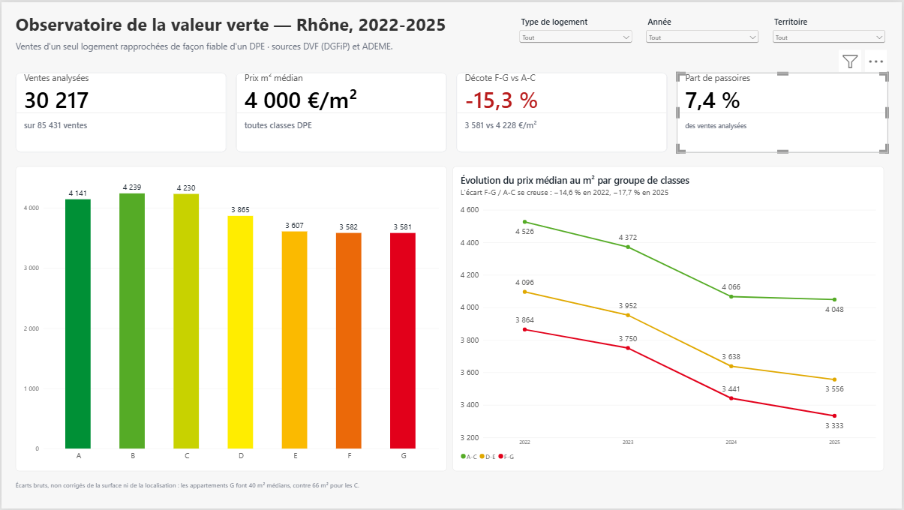
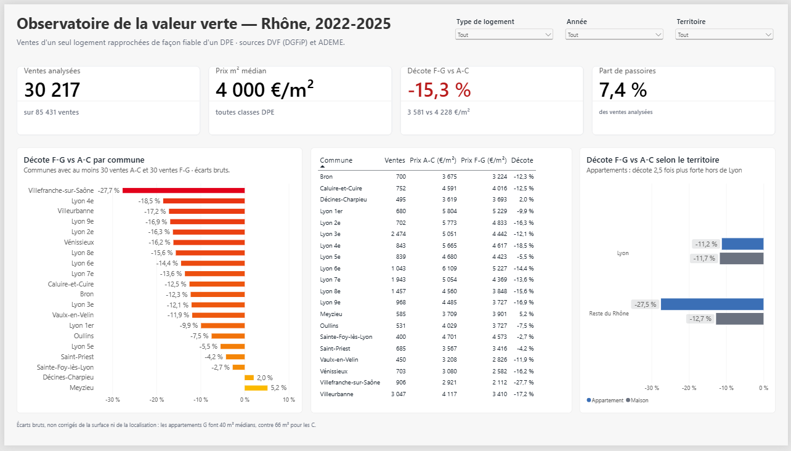
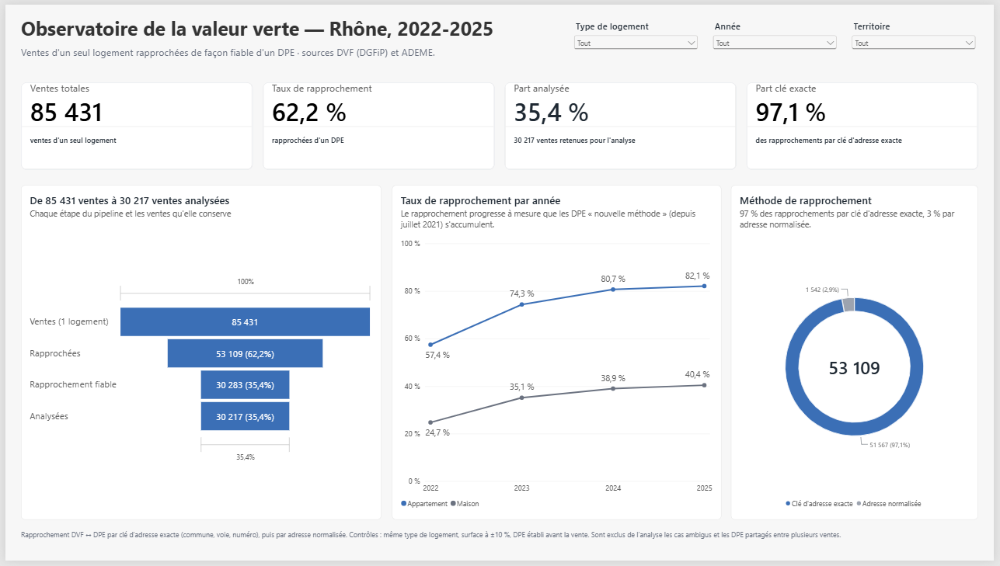
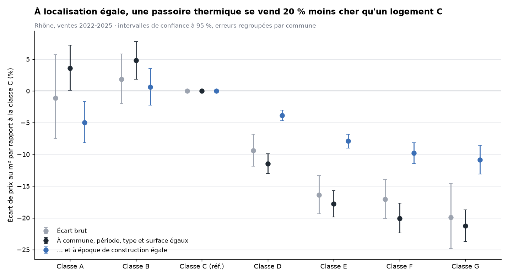

# 🏠 Observatoire de la valeur verte immobilière

**La performance énergétique d'un logement (DPE) influence-t-elle son prix de vente, et de combien ?**

Pipeline de données de bout en bout sur les ventes immobilières (DVF) et les diagnostics de performance
énergétique (ADEME) : ingestion, lakehouse bronze / silver / gold, transformations et tests avec dbt,
orchestration avec Airflow, dashboard Power BI et analyse statistique.

**Résultat principal : à commune, période, type et surface égaux, une passoire thermique (F-G) se vend
20 % moins cher au m² qu'un logement classé C** (intervalle de confiance à 95 % : −23 % à −18 %).

> 🚧 Projet en cours de construction. Périmètre de la version 1 : le Rhône, ventes 2022-2025.

- Cadrage complet (besoin, sources, architecture, plan) : [`docs/cadrage.md`](docs/cadrage.md)

## Avancement

| Étape | Statut |
| --- | --- |
| 1. Cadrage | ✅ |
| 2. Ingestion bronze (DVF, DPE) | ✅ |
| 3. Silver et rapprochement DVF ↔ DPE | ✅ |
| 4. Gold et tests de qualité | ✅ |
| 5. Orchestration (Airflow) et CI (GitHub Actions) | ⏳ |
| 6. Dashboard Power BI | ✅ |
| 7. Analyse de la valeur verte | ✅ |
| 8. Passage à l'échelle (France entière) | ⏳ |

## Premiers résultats (Rhône, 2022-2025)

| Étape | Volume |
| --- | --- |
| Lignes DVF ingérées | 354 101 |
| Ventes d'un seul logement (hors neuf) | 85 431 |
| DPE de logements ingérés | 517 849 |
| Ventes rapprochées d'un DPE | 53 109 (62 %) |
| dont ventes analysées (rapprochement fiable, prix plausible) | 30 217 |

**Le rapprochement en cascade** — DVF et les DPE n'ont aucun identifiant commun :
1. **Clé d'adresse exacte** (97 % des rapprochements) : l'identifiant BAN des DPE (`69266_2275_00006`) est reconstruit
   côté DVF à partir du code commune, du code de voie et du numéro.
2. **Adresse normalisée** en secours : noms de voie sans accents, sans type de voie ni mots de liaison
   (« AV GENERAL DE GAULLE » et « Avenue du Général de Gaulle » → « GENERAL GAULLE »).
3. **Contrôles** : même type de logement, surface à ±10 %, DPE établi avant la vente (3 ans maximum).
4. **Fiabilité** : on écarte de l'analyse les cas où plusieurs DPE d'étiquettes différentes sont possibles,
   et ceux où un même DPE est retenu pour plusieurs ventes.
5. **Déterminisme** : en cas d'égalité parfaite entre deux DPE candidats, le départage se fait sur le numéro
   de DPE. Sans cette règle, le résultat variait de quelques dizaines de ventes d'une exécution à l'autre
   (problème détecté en comparant le dashboard aux chiffres de référence).

Le taux de rapprochement progresse de 57 % (2022) à 82 % (2025) pour les appartements, à mesure que
la base des DPE « nouvelle méthode » (depuis juillet 2021) se remplit.

## Dashboard Power BI

**Les passoires thermiques (F-G) se vendent 15,3 % moins cher au m² que les logements A-C, et l'écart se creuse :
−14,6 % en 2022, −17,7 % en 2025.** Pour les appartements, la décote atteint −27,5 % hors de Lyon, contre −11,2 % dans Lyon.



| Page | Contenu |
| --- | --- |
| Vue d'ensemble | Chiffres clés, prix médian par classe DPE, évolution 2022-2025 |
| Territoires | Classement des 20 communes à décote fiable, comparaison Lyon / reste du Rhône |
| Qualité des données | Entonnoir du pipeline, taux de rapprochement par année, méthodes de rapprochement |




> Écarts **bruts** : ils ne tiennent pas compte de la surface, du type de logement ni de la localisation.
> Exemple d'effet de composition : à Meyzieu, la décote est positive (+5,2 %) parce que 90 % des passoires vendues
> sont des maisons, contre 31 % des logements A-C. L'analyse ci-dessous mesure l'effet propre du DPE.

Fichier : [`powerbi/observatoire_valeur_verte.pbix`](powerbi/observatoire_valeur_verte.pbix) · guide de construction :
[`docs/dashboard.md`](docs/dashboard.md)

## Analyse : la valeur verte « toutes choses égales par ailleurs »

Régression hédonique sur 30 217 ventes : logarithme du prix au m² expliqué par la classe DPE, le type de logement,
la surface, la commune et le trimestre de vente, avec erreurs standard regroupées par commune (Python, statsmodels).



| Résultat (F-G vs C) | Écart de prix au m² |
| --- | --- |
| Écart brut | −18,1 % |
| **À commune, période, type et surface égaux** | **−20,5 %** [−22,7 ; −18,3] |
| … et à époque de construction égale | −10,2 % [−11,7 ; −8,6] |
| Appartements / maisons | −23,4 % / −14,3 % |
| 2022 → 2025 | −19,1 % → −22,8 % (seul 2025 diffère significativement) |

- **La localisation masquait une partie de la décote** : beaucoup de passoires sont dans le centre de Lyon, où les prix sont élevés.
- **L'effet propre du DPE se situe vraisemblablement entre −10 % et −20 %** : l'époque de construction influence le prix
  pour d'autres raisons que l'énergie, mais elle est aussi la cause principale d'une mauvaise étiquette.
- **Robuste** aux règles de rapprochement et aux prix extrêmes (de −19,2 % à −20,8 % selon les variantes).
- **Cohérent avec les notaires** : exprimée par rapport à la classe D, comme dans leurs études, la décote est de −7 % à −10 %.

Note complète (méthode, segments, robustesse, limites) : [`docs/analyse.md`](docs/analyse.md) ·
code : [`analysis/valeur_verte.py`](analysis/valeur_verte.py)

## Modèle de données (couche gold)

Écrit en Parquet dans `data/gold/`, directement lisible par Power BI.

| Table | Contenu |
| --- | --- |
| `fait_ventes` | Une ligne par vente d'un seul logement, avec le DPE rapproché quand il existe |
| `dim_dpe` | Classes A à G, seuils de consommation, année d'interdiction à la location |
| `dim_commune` | Communes du Rhône, Lyon découpée en 9 arrondissements |
| `dim_temps` | Calendrier (année, trimestre, mois) |
| `agg_prix_m2` | Prix au m² médian et quartiles par commune, type, année et classe DPE (au moins 10 ventes) |
| `suivi_rapprochement` | Taux de rapprochement par commune, année et type, pour surveiller la qualité |

**Qualité des données : 43 tests dbt** (unicité, valeurs obligatoires, valeurs autorisées, intégrité
des relations entre tables), dont 3 tests métier :
- le taux de rapprochement global ne doit pas passer sous 50 % (sinon, une source a changé de format) ;
- un DPE rapproché est toujours antérieur à la vente ;
- une vente incluse dans l'analyse a toujours une étiquette DPE et un prix plausible.

## Lancer le projet

```bash
python -m venv .venv
.venv\Scripts\activate            # Windows (Mac/Linux : source .venv/bin/activate)
pip install -r requirements.txt
python -m pytest                  # tests
python -m ingestion.ingest_dvf    # ingestion des ventes (DVF)
python -m ingestion.ingest_dpe    # ingestion des diagnostics énergétiques (DPE), incrémentale
cd transform
dbt build                         # transformations silver et gold + 43 tests de qualité
dbt docs generate; dbt docs serve # documentation et graphe de lignage des données
cd ..
python analysis/valeur_verte.py  # analyse statistique (régressions, graphique)
```

---
Projet personnel de **Sarra Ben Messaoud** · [LinkedIn](https://www.linkedin.com/in/sarrabenmessaoud)
