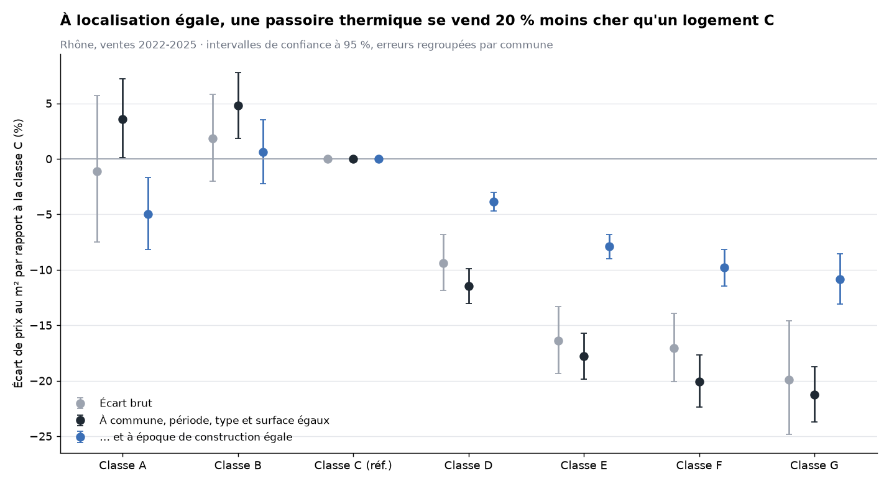

# Analyse — la valeur verte « toutes choses égales par ailleurs »

**À commune, période, type de logement et surface identiques, une passoire thermique (F-G) se vend environ
20 % moins cher au m² qu'un logement classé C.** Quand on compare en plus des bâtiments de la même époque
de construction, l'écart est d'environ 10 %. L'effet propre du DPE se situe vraisemblablement entre ces deux
bornes. Il est stable de 2022 à 2024 et se creuse en 2025.

Rhône, 30 217 ventes d'un seul logement rapprochées de façon fiable d'un DPE, 2022-2025.
Code : [`analysis/valeur_verte.py`](../analysis/valeur_verte.py) · résultats : [`analysis/resultats/`](../analysis/resultats/)

## 1. Pourquoi les écarts bruts ne suffisent pas

Le dashboard compare les prix médians par classe DPE. Mais les logements F-G ne sont pas des logements A-C
« en moins bien isolés » : ils sont souvent plus petits, plus anciens, situés ailleurs. Deux exemples tirés des données :
- les appartements classés G font 40 m² en médiane, contre 66 m² pour les C ;
- à Meyzieu, la décote brute est même positive (+5,2 %), parce que 90 % des passoires vendues y sont des maisons,
  contre 31 % des logements A-C.

Pour isoler l'effet du DPE, il faut comparer des logements comparables.

## 2. La méthode : une régression hédonique

C'est la méthode de référence pour mesurer la « valeur verte » (utilisée notamment par les notaires).
On explique le prix au m² (en logarithme) par la classe DPE et par les autres caractéristiques du logement :

```math
\log(\text{prix au m}^2) = \text{classe DPE} + \text{type} + \log(\text{surface}) + \text{commune} + \text{trimestre de vente} \;[+\; \text{époque de construction}]
```

- **Classe de référence : C**, la plus fréquente. Chaque coefficient, converti en pourcentage, donne l'écart de prix
  d'une classe par rapport à C, à caractéristiques égales.
- **Effets fixes commune et trimestre** : on ne compare que des ventes de la même commune, à la même période.
- **Erreurs standard regroupées par commune** : les ventes d'une même commune ne sont pas indépendantes ;
  sans cette correction, les intervalles de confiance seraient trop étroits.

## 3. Résultats



| Modèle | Contrôles | D | E | F | G |
| --- | --- | --- | --- | --- | --- |
| 1. Brut | aucun | −9,4 % | −16,4 % | −17,1 % | −19,9 % |
| 2. | + type, surface | −9,1 % | −17,0 % | −18,3 % | −21,8 % |
| **3. Principal** | **+ commune, trimestre** | **−11,5 %** | **−17,8 %** | **−20,1 %** | **−21,3 %** |
| 4. | + époque de construction | −3,9 % | −7,9 % | −9,8 % | −10,8 % |

Écarts par rapport à la classe C. Les intervalles de confiance à 95 % sont sur le graphique et dans
`analysis/resultats/effets_par_modele.csv`. Pouvoir explicatif (R²) : 0,04 pour le modèle brut, 0,57 pour le modèle principal.

**Lecture 1 — la localisation masquait une partie de la décote.** En passant du modèle 1 au modèle 3, la décote des
F-G augmente au lieu de diminuer. Beaucoup de passoires sont dans le centre de Lyon, où les prix sont élevés :
leur emplacement compensait en partie leur mauvaise étiquette dans les écarts bruts.

**Lecture 2 — l'époque de construction : contrôler ou non ?** Ajouter l'époque de construction divise la décote
par deux. C'est le point délicat de l'analyse :
- l'âge du bâtiment influence le prix pour d'autres raisons que l'énergie (architecture, qualité, charme de l'ancien,
  emplacement au sein de la commune) : il faut alors le contrôler ;
- mais l'âge est aussi la cause principale de la mauvaise étiquette : le contrôler retire une partie de l'effet énergétique
  qu'on cherche à mesurer.

Le modèle 3 surestime donc probablement l'effet propre du DPE, et le modèle 4 le sous-estime : **la valeur verte se situe
vraisemblablement entre −10 % et −20 % pour une passoire par rapport à un logement C.**

### Par segment (F-G vs C)

| Segment | Ventes | Commune, trimestre | + époque de construction |
| --- | --- | --- | --- |
| Tous logements | 30 217 | −20,5 % [−22,7 ; −18,3] | −10,2 % [−11,7 ; −8,6] |
| Appartements | 23 047 | −23,4 % [−26,5 ; −20,2] | −13,5 % [−14,9 ; −12,0] |
| Maisons | 7 170 | −14,3 % [−16,9 ; −11,6] | −9,0 % [−11,6 ; −6,4] |
| Lyon | 10 949 | −16,6 % [−19,1 ; −13,9] | −11,6 % [−13,1 ; −10,0] |
| Reste du Rhône | 19 268 | −23,0 % [−24,8 ; −21,2] | −10,3 % [−12,4 ; −8,2] |
| Appartements, reste du Rhône | 12 282 | −29,2 % [−31,3 ; −27,0] | −15,4 % [−17,6 ; −13,2] |

Entre crochets : intervalle de confiance à 95 %. La décote est plus forte pour les appartements et hors de Lyon,
ce que montrait déjà le dashboard ; à époque de construction égale, l'écart entre Lyon et le reste du Rhône disparaît presque.

### Évolution dans le temps (F-G vs C, commune et trimestre contrôlés)

| Année | Décote | Écart avec 2022 significatif ? |
| --- | --- | --- |
| 2022 | −19,1 % | référence |
| 2023 | −20,4 % | non (p = 0,29) |
| 2024 | −19,5 % | non (p = 0,73) |
| 2025 | −22,8 % | **oui (p = 0,002)** |

La décote est stable de 2022 à 2024 et se creuse en 2025, année où les logements classés G sont devenus interdits
à la location (loi Climat et Résilience). Le calendrier concorde, mais l'analyse ne prouve pas la causalité.

### Robustesse

| Variante | Ventes | F-G vs C |
| --- | --- | --- |
| Modèle principal | 30 217 | −20,5 % |
| Sans les DPE générés à partir d'un DPE d'immeuble | 30 158 | −20,6 % |
| Rapprochement strict (surface à ±5 %) | 25 650 | −20,4 % |
| DPE établi moins d'un an avant la vente | 24 325 | −20,8 % |
| Hors 1 % des prix extrêmes (de chaque côté) | 29 611 | −19,2 % |

Le résultat ne dépend ni des règles de rapprochement, ni des valeurs extrêmes.

## 4. Comparaison avec les études publiées

Les notaires mesurent la valeur verte par rapport à la classe **D**. Exprimée de la même façon, notre décote F-G vs D
est de **−10,2 %** (commune et trimestre contrôlés) à **−6,6 %** (avec l'époque de construction) ; −12,3 % à −10,0 %
pour les appartements, −9,8 % à −6,7 % pour les maisons.

C'est le même ordre de grandeur que l'étude du Conseil supérieur du notariat sur les ventes de 2021 : jusqu'à −11 %
pour les appartements les plus énergivores en région, et des écarts de l'ordre de ±6 % pour les maisons en
Auvergne-Rhône-Alpes ([Maire-info, novembre 2022](https://www.maire-info.com/logement/les-logements-mal-isoles-connaissent-une-decote-en-regions-art26-26969)).
Nos données étant plus récentes (2022-2025), un écart un peu plus marqué est cohérent avec le durcissement de la réglementation.

## 5. Limites

- **Corrélation, pas causalité.** Des caractéristiques non observées (état général, étage, vue, travaux à prévoir)
  peuvent être liées à la fois à l'étiquette et au prix.
- **Échantillon rapproché.** 35 % des ventes sont analysées ; le rapprochement est moins fréquent pour les maisons
  (40 % en 2025 contre 82 % pour les appartements), ce qui peut biaiser les résultats sur les maisons.
- **Qualité des DPE.** Les diagnostics sont des données déclaratives ; la méthode de calcul a été corrigée en 2024
  pour les petites surfaces, ce qui peut affecter la comparaison entre années.
- **Un seul département.** Les résultats valent pour le Rhône ; l'étape 8 étendra l'analyse à la France entière.

## Sources

- [Les logements mal isolés connaissent une décote en régions — Maire-info, 30 novembre 2022](https://www.maire-info.com/logement/les-logements-mal-isoles-connaissent-une-decote-en-regions-art26-26969)
