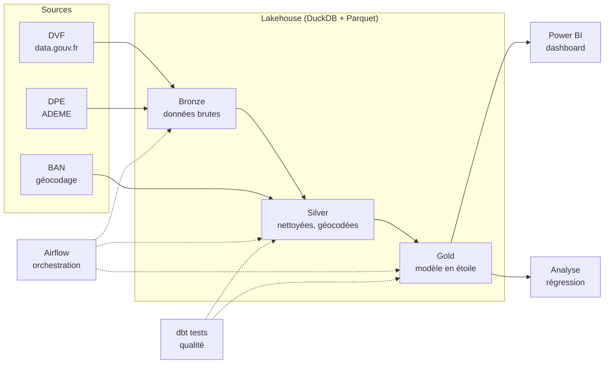

# Cadrage — Observatoire de la valeur verte immobilière

## 1. La question métier

**La performance énergétique d'un logement (son DPE) influence-t-elle son prix de vente, et de combien ?**

Depuis la loi Climat et Résilience, les logements les plus énergivores sont progressivement interdits à la location
(selon le calendrier de la loi : classe G depuis 2025, F en 2028, E en 2034 ; à revérifier, car ce calendrier fait l'objet de débats). Un logement mal classé devient donc plus difficile à louer, plus coûteux
à rénover, et potentiellement moins cher à la revente.

Pour une banque qui prête sur ces biens, c'est un **risque sur la valeur des garanties** (collatéral) et un enjeu
de **reporting ESG**. Pour un investisseur ou une collectivité, c'est un indicateur de marché et de politique publique.

## 2. Utilisateurs et questions auxquelles l'observatoire répond

| Utilisateur | Ses questions |
| --- | --- |
| Analyste risque crédit immobilier (banque) | Quelle décote pour un bien classé F ou G dans mon portefeuille ? Où est-elle la plus forte ? |
| Équipe ESG / reporting | Quelle part des ventes concerne des « passoires thermiques » ? Comment évolue-t-elle ? |
| Investisseur / gestionnaire de patrimoine | Où l'écart de prix entre classes DPE est-il le plus fort ? Est-ce qu'il se creuse dans le temps ? |
| Collectivité | La valeur verte varie-t-elle selon les communes et les types de logements ? |

**Questions analytiques :**
1. Quel est le prix médian au m² par classe DPE (A à G), par département, commune et type de logement ?
2. Quel est l'écart de prix entre classes DPE **toutes choses égales par ailleurs** (surface, localisation, nombre de pièces, année) ?
3. Cet écart évolue-t-il dans le temps, notamment autour des échéances de la loi Climat et Résilience ?
4. Quelle est la part des ventes de logements classés F ou G, et comment évolue-t-elle ?

## 3. Les sources de données

| Source | Contenu | Producteur | Mise à jour | Accès |
| --- | --- | --- | --- | --- |
| [DVF géolocalisées](https://www.data.gouv.fr/datasets/demandes-de-valeurs-foncieres-geolocalisees) | Toutes les ventes immobilières (prix, date, surface, type, adresse, parcelle, coordonnées) | DGFiP, retraitées par data.gouv.fr | Semestrielle (5 années glissantes) | CSV par année |
| [DPE Logements existants (depuis juillet 2021)](https://www.data.gouv.fr/datasets/dpe-logements-existants-depuis-juillet-2021) | Diagnostics de performance énergétique (étiquettes énergie et climat, surface, type, adresse) | ADEME | Hebdomadaire | API, export, requêtes DuckDB à distance |
| [Base Adresse Nationale](https://adresse.data.gouv.fr/) | Référentiel des adresses, identifiant d'adresse commun | État (IGN, DINUM) | Continue | API de géocodage en masse |
| INSEE (à préciser) | Population, revenus par commune | INSEE | Annuelle | CSV |

Licence : Licence Ouverte 2.0 pour DVF et DPE.

## 4. La difficulté principale : rapprocher une vente et un DPE

**DVF et la base DPE n'ont aucun identifiant commun.** Il faut retrouver, pour chaque vente, le DPE du même logement.

Méthode prévue :
1. **Normaliser et géocoder** les adresses des deux sources avec la Base Adresse Nationale, pour obtenir un identifiant d'adresse commun.
2. **Joindre** sur cet identifiant, avec le même type de logement (appartement ou maison).
3. **Désambiguïser** quand plusieurs DPE correspondent (fréquent en immeuble) : surface proche (± 10 %), DPE établi dans une fenêtre avant la vente.
4. **Mesurer le taux de rapprochement** et le documenter honnêtement.

À titre de repère, le Cerema obtient environ 20 % de logements rapprochés avec un DPE dans un atelier de méthode
(calcul à partir des effectifs publiés). Un taux modeste est attendu : un DPE n'existe que pour les logements
vendus ou loués depuis juillet 2021.

## 5. Périmètre de la version 1

- **Zone :** un département pour démarrer (à choisir), puis extension à la France entière pour démontrer le passage à l'échelle.
- **Période :** ventes de 2022 à 2025 (période couverte à la fois par DVF et par les DPE « nouvelle méthode »).
- **Biens :** ventes simples (un seul logement) d'appartements et de maisons. Exclusion des ventes multi-lots, des dépendances seules, des terrains.

## 6. Architecture

| Couche | Rôle | Outils |
| --- | --- | --- |
| Ingestion | Téléchargement automatique et incrémental des sources | Python |
| Bronze | Données brutes, telles que reçues, au format Parquet | DuckDB |
| Silver | Données nettoyées, typées, filtrées, géocodées | dbt + DuckDB |
| Gold | Modèle en étoile prêt pour l'analyse | dbt + DuckDB |
| Qualité | Tests automatiques à chaque exécution | dbt tests |
| Orchestration | Pipeline planifié de bout en bout | Airflow (Docker) |
| Industrialisation | Tests automatiques du code à chaque modification | Git, GitHub Actions |
| Restitution | Dashboard interactif | Power BI |
| Analyse | Écart de prix « toutes choses égales par ailleurs » | Python (statsmodels) |

**Pourquoi DuckDB plutôt qu'un entrepôt cloud :** gratuit, rapide sur plusieurs millions de lignes, et il tourne
sur un ordinateur portable. Le code dbt reste le même si l'on passe ensuite à Databricks ou Snowflake : seule la
connexion change. C'est un argument d'architecture à expliquer en entretien.

## 7. Modèle de données (couche gold)

- **fait_vente** : une ligne par vente rapprochée (prix, surface, prix au m², date, nombre de pièces, classes DPE énergie et climat).
- **dim_commune** : commune, département, région, population, revenu médian.
- **dim_temps** : date, mois, trimestre, année.
- **dim_dpe** : classe (A à G), libellé, statut réglementaire (interdit à la location à partir de quelle année).
- **suivi_rapprochement** : taux de rapprochement par commune et par période, pour suivre la qualité.

## 8. Qualité des données

Tests automatiques prévus :
- Unicité des identifiants (vente, DPE) dans chaque couche.
- Valeurs obligatoires non nulles (prix, surface, date, classe DPE).
- Valeurs acceptées (classes A à G, types de logement).
- Bornes métier : prix au m² dans une fourchette plausible, surface entre 9 m² et 1 000 m².
- Taux de rapprochement suivi à chaque exécution, avec alerte s'il chute brutalement.

## 9. KPIs du dashboard

- Prix médian au m² par classe DPE, par territoire et type de logement.
- Écart de prix estimé entre classes (avec intervalle de confiance).
- Part des ventes de passoires thermiques (F et G) dans le temps.
- Nombre de ventes et taux de rapprochement (pour juger la fiabilité des chiffres).

## 10. Plan par étapes

| Étape | Livrable | Ce que ça démontre |
| --- | --- | --- |
| 1. Cadrage | Ce document | Recueil du besoin, vision produit |
| 2. Ingestion bronze | Script d'ingestion incrémental, fichiers Parquet | Python, gestion de gros fichiers |
| 3. Silver et rapprochement | Modèles dbt, géocodage, appariement DVF ↔ DPE, taux mesuré | SQL avancé, dbt, qualité des données |
| 4. Gold et tests | Modèle en étoile, tests dbt, documentation dbt | Modélisation, data quality |
| 5. Orchestration et CI | DAG Airflow, GitHub Actions | Industrialisation |
| 6. Dashboard | Rapport Power BI | Restitution métier |
| 7. Analyse | Régression et note de résultats | Analyse statistique |
| 8. Passage à l'échelle | France entière, mesures de performance | Scalabilité |
| 9. Bonus | Agent IA en langage naturel sur la couche gold | Lien avec le projet RAG |

## 11. Limites et risques connus

- **Biais de sélection :** les DPE ne concernent que les logements vendus ou loués depuis juillet 2021 ; ils ne sont pas représentatifs du parc complet.
- **Qualité des DPE :** données brutes saisies par les diagnostiqueurs, non corrigées par l'ADEME.
- **Taux de rapprochement modeste** attendu : les résultats porteront sur l'échantillon rapproché, à documenter.
- **Corrélation, pas causalité :** l'écart de prix estimé peut refléter d'autres caractéristiques non observées (état général, étage, vue).
- **Conditions de réutilisation de DVF :** pas de réidentification des personnes ; les résultats publiés sont agrégés.
